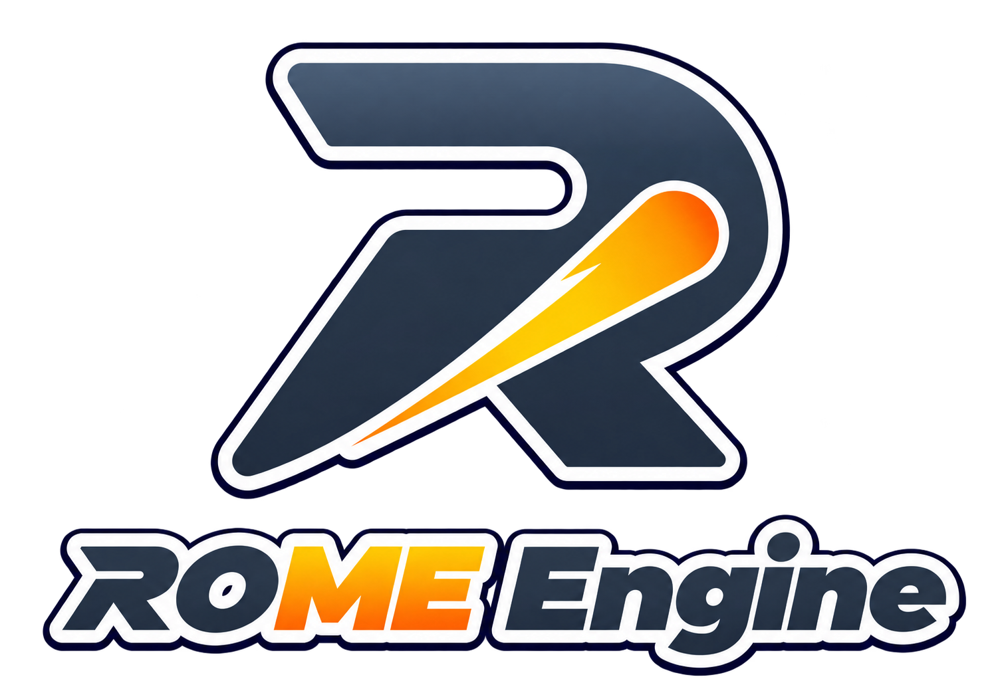
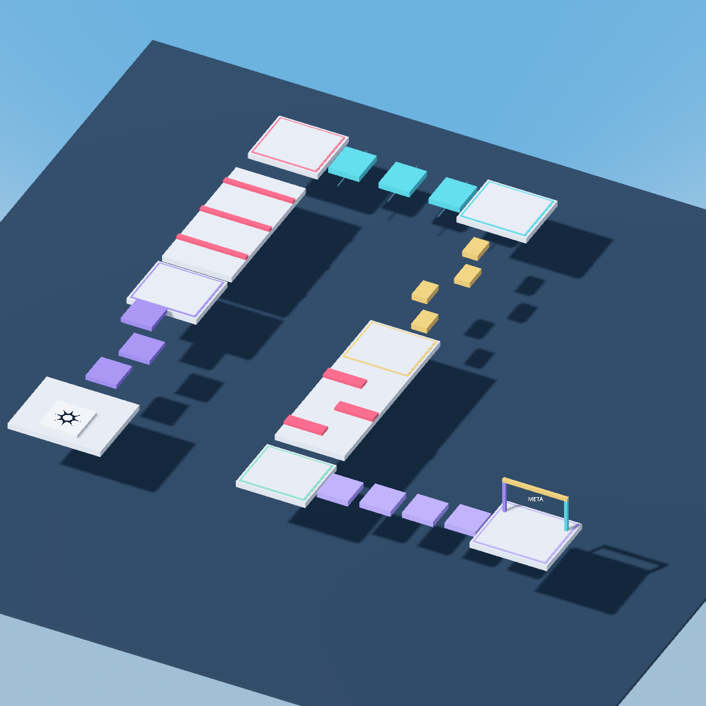

<p align="center">
  
</p>

# ROME Engine · 0.1.0-alpha.2

**Rocket Meteor Engine** es un motor experimental basado en Godot, con un editor
inspirado en el flujo de trabajo de Roblox Studio y programación en Luau mediante
[GodotLuau](https://github.com/Pimpoli/GodotLuau).

## Descargar la alpha

[**ROME Engine 0.1.0-alpha.2 — descargas y notas de la versión**](https://github.com/Pimpoli/ROME-Engine/releases/tag/v0.1.0-alpha.2)

Los archivos se encuentran en **Assets** de esa versión. Esta es una
**pre-release**: utiliza el enlace anterior para encontrarla, ya que GitHub puede
mostrar otra versión en su enlace de última publicación estable.

| Plataforma | Estado de esta alpha |
| --- | --- |
| Windows x86_64 | Ejecutable autónomo; editor probado en Windows. |
| Linux x86_64 | Compilación mediante CI. El binario solo estará disponible cuando el workflow termine correctamente y se adjunte a la versión. |
| Android | Pendiente; no se ofrece todavía un APK de ROME validado. |
| macOS y otras plataformas | Pendientes; sin binarios de ROME validados para esta alpha. |

### Abrir en Windows

Descarga el **`.exe` autónomo** desde los Assets de la versión y ábrelo con doble
clic. Incluye el runtime de ROME y GodotLuau; no requiere instalar una copia de
Godot o colocar manualmente una carpeta de componentes junto al archivo.

En el primer inicio, el editor extrae sus componentes a una **caché del usuario**
identificada por versión y paquete. Las siguientes ejecuciones reutilizan esa
copia. Este paquete no utiliza un asistente de instalación.

### Actualizaciones

Desde la 0.1.0-alpha.2, ROME se actualiza solo: al arrancar consulta las
versiones publicadas en Releases, descarga en segundo plano el ejecutable de tu
plataforma y comprueba su SHA-256. La versión nueva se instala al cerrar el
editor, o al momento con **Ayuda > Actualizaciones de ROME > Actualizar y
reiniciar**, que reabre la misma experiencia. Si algo falla, ROME vuelve a abrir
la versión anterior. La 0.1.0-alpha.1 no traía actualizador: quien la tenga
descarga esta versión a mano una sola vez.

GodotLuau viaja dentro de ROME y se actualiza con él; su actualizador propio
queda desactivado en las experiencias de ROME para no instalar una compilación
que no sea la adaptada.

Las experiencias también se ponen al día solas: al abrir una con otra versión
de ROME, el editor sustituye su copia de ROMEStudio y GodotLuau por la de su
versión antes de cargarla. Nunca toca escenas, assets, tus carpetas de scripts
ni el logo del juego. Respeta los scripts por defecto que hayas editado
(`GodotLuau/DefaultScripts`) y deja lo sustituido en `.rome/backup-…` dentro
de la experiencia. Si un archivo está en uso, la experiencia queda tal cual y
se reintenta al abrirla la próxima vez.

## Base del motor

ROME conserva el núcleo de Godot y sus escenas reutilizables, mientras desarrolla
su propia interfaz, organización de recursos y herramientas de creación. Su base
actual es **Godot 4.8 beta 1**, commit
[`4d10419cacd6d3009976e8f9fd3abd970fd58018`](https://github.com/godotengine/godot/commit/4d10419cacd6d3009976e8f9fd3abd970fd58018).
Las actualizaciones de esa base se integran y prueban en este fork; no se aplican
automáticamente.

**0.1.0-alpha.2 es la versión pública de ROME**; 4.8 beta 1 identifica la base
técnica de Godot. El repositorio publica una instantánea del código derivado y
no está registrado como fork en la red de repositorios de GitHub. El origen y
el proceso para integrar cambios del núcleo se documentan en [UPSTREAM.md](rome/UPSTREAM.md).

## Qué incluye

- **Inicio de experiencias** con las plantillas Baseplate, En blanco y Classic Obby.
- **Barra de herramientas** con Inicio, Avatar, UI, Script, Modelo y Plugins.
  Pieza, Script, GUI, Material, Color, Grupo, Bloquear y Anclar tienen su menú
  desplegable; el ajuste de movimiento y giro se activa con su casilla, y los
  atajos son los de Studio (Ctrl+1…5, Ctrl+L, Ctrl+G, Ctrl+U). El botón **+**
  crea pestañas personalizadas con herramientas, separadores y opciones para
  renombrar, duplicar y reorganizar.
- **Pestañas compartidas para escenas y scripts**. Cada script muestra su nombre
  con el icono de su tipo; seleccionar una escena vuelve a su mundo y
  seleccionar un script abre su código. Clic central cierra la pestaña.
- **Insertar objeto** con buscador, categorías y objetos recientes, también desde
  el **+** que aparece al pasar por cada fila del Explorador. Las piezas nuevas
  aparecen delante de la cámara.
- **Propiedades por secciones** (Datos, Apariencia, Colisión, Comportamiento…)
  con **Atributos** que se agregan y eliminan desde el panel.
- **Recursos organizados por carpetas**, con creación de carpetas y acceso al
  navegador de archivos completo. `Scenes` se muestra con el nombre traducido
  del editor, como **Escenas**, sin cambiar sus rutas. Los scripts se organizan
  en `Scripts/LocalScript`, `Scripts/ServerScript` y `Scripts/ModuleScript`.
- **Explorador con servicios fijos** en la escena principal y escenas de modelos
  reutilizables que no necesitan repetir esa jerarquía.
- **Classic Obby de seis etapas**, con plataformas móviles, obstáculos letales,
  checkpoints y HUD. El movimiento y transporte de pasajeros se ejecutan en
  LocalScript; el daño, avance y respawn se controlan desde el servidor.

<p align="center">
  
</p>

## Estado del proyecto

La versión actual se ha compilado y probado en **Windows x86_64**. La conversión
del editor sigue en desarrollo: algunas herramientas avanzadas permanecen
deshabilitadas y la interfaz todavía no reproduce todas las funciones de Studio.
Las demás plataformas heredadas de Godot no se han validado específicamente
para ROME.

ROME y GodotLuau son proyectos independientes de Roblox. No incluyen sus
servicios en la nube ni garantizan ejecutar sin cambios cualquier experiencia,
plugin o API de Roblox. La plantilla Obby se ha probado en ejecución local;
su funcionamiento entre procesos separados de cliente y servidor requiere
validación adicional.

El árbol de Git contiene el **código fuente**, los recursos de ROME y sus
herramientas de construcción. Los ejecutables, DLL y paquetes generados se
distribuyen como Assets de las versiones y no se versionan en ese árbol.

## Compilar en Windows

### Requisitos

- Git.
- Python **3.10 o posterior** y SCons **4.4 o posterior**, disponibles en `PATH`.
- Visual Studio 2022 o Build Tools con **Desarrollo para el escritorio con C++**,
  el compilador MSVC y un Windows SDK.
- Para construir GodotLuau con el script incluido: **MSYS2 UCRT64 / MinGW-w64**,
  con `g++` y sus herramientas en `PATH`. Ese script usa `use_mingw=yes`.
- Acceso a Internet al preparar por primera vez las dependencias públicas de
  GodotLuau: `godot-cpp` y `luau`. Las revisiones utilizadas se fijan en el
  manifiesto de dependencias de la copia incluida.

Las herramientas C++ y el SDK se instalan por separado. SCons puede instalarse
con `python -m pip install scons`.

### Obtener los fuentes

En PowerShell:

```powershell
git clone https://github.com/Pimpoli/ROME-Engine.git
Set-Location ROME-Engine
python rome/setup_dependencies.py
```

Esta versión incluye en **`rome/vendor/GodotLuau/`** una copia de los fuentes de
GodotLuau usados por la integración, que declara la versión **1.16.12**. La copia
incluye cambios de desarrollo que pueden no estar todavía en su repositorio
público. El script prepara `godot-cpp` y `luau` a partir de sus repositorios
públicos y revisiones fijadas; no necesitas reconstruir esa copia a partir de
otra versión de GodotLuau.

El proyecto GodotLuau continúa manteniéndose por separado. La inclusión de estos
fuentes no modifica el checkout original utilizado por sus desarrolladores.

### Construir y empaquetar

Desde la raíz de ROME:

```powershell
scons platform=windows target=editor -j6
python rome/build_runtime.py --source rome/vendor/GodotLuau --jobs 6 --target both
python rome/package_runtime.py --source rome/vendor/GodotLuau --binary-source ./bin/rome_extension_build/GodotLuau/bin
& './bin/ROME Studio.exe' --project-manager
```

Ajusta `-j6` y `--jobs 6` a los recursos de tu equipo. El primer comando construye
el editor; los siguientes construyen e incorporan la extensión y crean el
paquete local que utilizan las plantillas.

`build_runtime.py` trabaja sobre una **copia de compilación** en
`bin/rome_extension_build`, sin editar el checkout de GodotLuau. Allí aplica los
ajustes de compatibilidad con Godot 4.8 para las colisiones de los nombres
`get_gravity` y `TextDirection`, conservando la API pública de Luau. GodotLuau
continúa siendo un proyecto mantenido por separado.

Esta construcción local produce un editor con **`bin/rome_runtime` junto al
ejecutable**: conserva esa carpeta, que contiene la extensión, los addons y los
recursos necesarios para crear experiencias. Si el editor público está abierto
al empaquetar, se genera `ROME Studio Preview.exe` como alternativa.

Para crear el archivo autónomo que incorpora esos componentes:

```powershell
python rome/package_standalone.py --editor ./bin/godot.windows.editor.x86_64.exe --runtime ./bin/rome_runtime --output ./bin/ROME-Studio-0.1.0-alpha.2-windows-x86_64.exe
```

El nombre de salida es libre, pero si sigue el formato de las versiones debe
llevar la versión compilada; es el nombre que busca el actualizador en Releases.
La herramienta también escribe su archivo de verificación SHA-256. El paquete autónomo extrae el runtime a la caché
del usuario al iniciarse, por lo que puede distribuirse sin una carpeta vecina.

### Actualizar únicamente ROME

Cuando ya existe un paquete local y no quieres reconstruir ni reemplazar los
componentes de GodotLuau:

```powershell
scons platform=windows target=editor -j6
python rome/package_runtime.py --rome-only
```

Este modo actualiza el editor, ROMEStudio y sus recursos. No reescribe el código,
los componentes del addon ni los binarios de GodotLuau. Las experiencias
existentes reciben el ROMEStudio nuevo la próxima vez que se abren, pero sus
escenas no se regeneran; crea una nueva desde la plantilla para obtener su
última versión.

## Empezar a crear

Abre **ROME Studio**, elige una plantilla y guarda tus escenas y recursos en la
experiencia creada. La escena principal tiene un nombre independiente del
nombre del juego. Las demás escenas pueden utilizarse como modelos reutilizables.

Los archivos de código se guardan actualmente con extensión **`.lua`**, aunque
su contenido utiliza Luau, porque ese es el formato registrado por el cargador
de la extensión integrada. La pestaña del editor muestra el nombre lógico y
el tipo del script.

## Desarrollo y documentación

- [Cómo contribuir](CONTRIBUTING.md): estructura, cambios y comprobaciones.
- [Guía técnica de ROME](rome/README.md): construcción, empaquetado y recursos.
- [Estado y notas de implementación](rome/PROGRESS.md).
- [Origen de los fuentes y mantenimiento de la base](rome/UPSTREAM.md).
- [Documentación de GodotLuau](https://github.com/Pimpoli/GodotLuau#readme).
- [README original de Godot](README.godot.md) y
  [guía original de contribución](CONTRIBUTING.godot.md), conservados como referencia.

Para errores o propuestas de ROME, utiliza
[Issues de este repositorio](https://github.com/Pimpoli/ROME-Engine/issues).

## Licencia y créditos

El núcleo heredado de Godot conserva su licencia MIT en
[LICENSE.txt](LICENSE.txt), sus [autores](AUTHORS.md) y los avisos de dependencias
en [COPYRIGHT.txt](COPYRIGHT.txt). GodotLuau mantiene su propia licencia y créditos
en su repositorio y en los paquetes que lo incorporan.

Las aportaciones propias de ROME se distribuyen bajo la licencia MIT de
[LICENSE](LICENSE). La instantánea de GodotLuau conserva su [licencia propia](rome/vendor/GodotLuau/LICENSE).

ROME es un proyecto de **Rocket Meteor / PimpoliDev**. Los cambios de interfaz
y marca no eliminan las atribuciones del software del que deriva.
