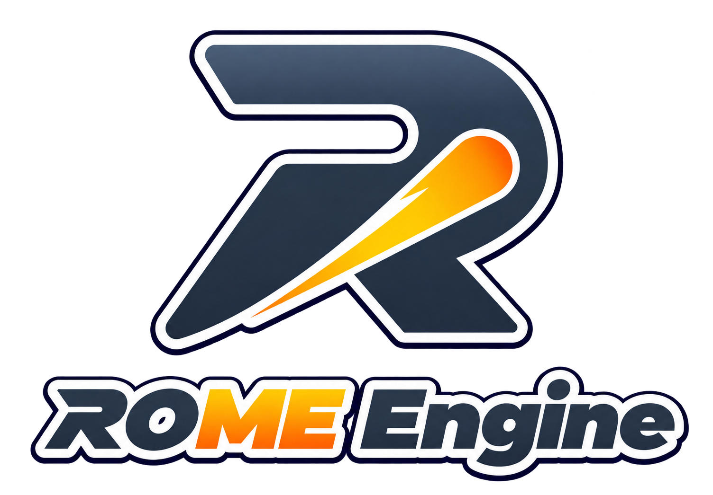
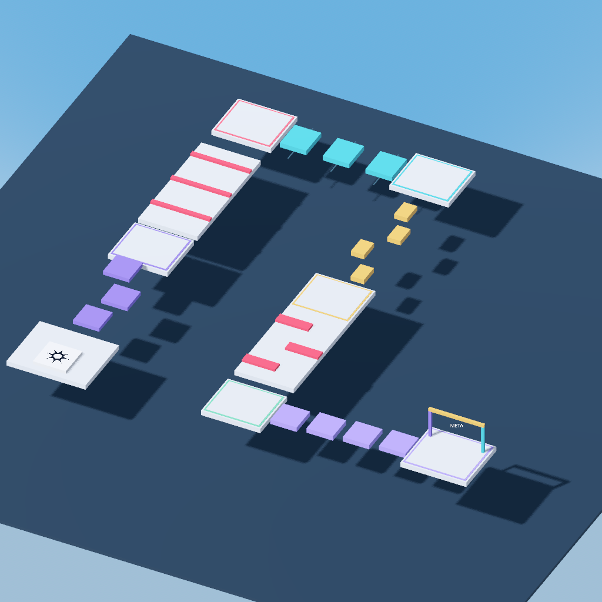

<p align="center">
  
</p>

# ROME Engine · 0.1.0-alpha.4

**Rocket Meteor Engine** es un motor experimental basado en Godot, con un editor
inspirado en el flujo de trabajo de Roblox Studio y programación en Luau mediante
[GodotLuau](https://github.com/Pimpoli/GodotLuau).

## Descargar la alpha

[**ROME Engine 0.1.0-alpha.4 — descargas y notas de la versión**](https://github.com/Pimpoli/ROME-Engine/releases/tag/v0.1.0-alpha.4)

Los archivos se encuentran en **Assets** de esa versión. Esta es una
**pre-release**: utiliza el enlace anterior para encontrarla, ya que GitHub puede
mostrar otra versión en su enlace de última publicación estable.

| Plataforma | Estado de esta alpha |
| --- | --- |
| Windows x86_64 | Ejecutable autónomo; editor probado en Windows. |
| Linux x86_64 | Compilación mediante CI. El binario solo estará disponible cuando el workflow termine correctamente y se adjunte a la versión. |
| Android | Pendiente; no se ofrece todavía un APK de ROME validado. |
| macOS y otras plataformas | Pendientes; sin binarios de ROME validados para esta alpha. |

### Abrir en Windows

Descarga el **`.exe` autónomo** desde los Assets de la versión y ábrelo con doble
clic. Incluye el runtime de ROME y GodotLuau; no requiere instalar una copia de
Godot o colocar manualmente una carpeta de componentes junto al archivo.

En el primer inicio, el editor extrae sus componentes a una **caché del usuario**
identificada por versión y paquete. Las siguientes ejecuciones reutilizan esa
copia. Este paquete no utiliza un asistente de instalación.

### Si Windows muestra un aviso

ROME todavía no tiene firma digital, así que al abrir el `.exe` descargado
Windows puede mostrar **«Windows protegió su PC»** con el editor desconocido. El
aviso significa que Windows no reconoce al autor del archivo, no que haya
detectado un virus. Para abrirlo:

1. Pulsa **Más información**.
2. Pulsa **Ejecutar de todas formas**.

Normalmente solo sale con el archivo descargado desde el navegador: las
actualizaciones que ROME instala por su cuenta no lo muestran.

Descarga ROME solo desde [Releases](https://github.com/Pimpoli/ROME-Engine/releases).
Para comprobar que el archivo es el publicado, abre PowerShell en la carpeta de la
descarga, ejecuta este comando con el nombre de tu versión y compara el resultado
con el SHA-256 de sus notas:

```powershell
Get-FileHash .\ROME-Studio-0.1.0-alpha.4-windows-x86_64.exe -Algorithm SHA256
```

### Actualizaciones

Desde la 0.1.0-alpha.2, ROME se actualiza solo: al arrancar consulta las
versiones publicadas en Releases, descarga en segundo plano el ejecutable de tu
plataforma y comprueba su SHA-256. La versión nueva se instala al cerrar el
editor, o al momento con **Ayuda > Actualizaciones de ROME > Actualizar y
reiniciar**, que reabre la misma experiencia. Si algo falla, ROME vuelve a abrir
la versión anterior. Desde la 0.1.0-alpha.3, si la conexión se corta o va muy
lenta, la descarga se reanuda sola desde donde quedó, también la próxima vez que
abras ROME. La 0.1.0-alpha.1 no traía actualizador: quien la tenga descarga esta
versión a mano una sola vez.

GodotLuau viaja dentro de ROME y se actualiza con él; su actualizador propio
queda desactivado en las experiencias de ROME para no instalar una compilación
que no sea la adaptada.

Las experiencias también se ponen al día solas: al abrir una con otra versión
de ROME, el editor sustituye su copia de ROMEStudio y GodotLuau por la de su
versión antes de cargarla. Nunca toca escenas, assets, tus carpetas de scripts
ni el logo del juego. Respeta los scripts por defecto que hayas editado
(`GodotLuau/DefaultScripts`) y deja lo sustituido en `.rome/backup-…` dentro
de la experiencia. Si un archivo está en uso, la experiencia queda tal cual y
se reintenta al abrirla la próxima vez.

## Base del motor

ROME conserva el núcleo de Godot y sus escenas reutilizables, mientras desarrolla
su propia interfaz, organización de recursos y herramientas de creación. Su base
actual es **Godot 4.8 beta 1**, commit
[`4d10419cacd6d3009976e8f9fd3abd970fd58018`](https://github.com/godotengine/godot/commit/4d10419cacd6d3009976e8f9fd3abd970fd58018).
Las actualizaciones de esa base se integran y prueban en este fork; no se aplican
automáticamente.

**0.1.0-alpha.4 es la versión pública de ROME**; 4.8 beta 1 identifica la base
técnica de Godot. El repositorio publica una instantánea del código derivado y
no está registrado como fork en la red de repositorios de GitHub. El origen y
el proceso para integrar cambios del núcleo se documentan en [UPSTREAM.md](rome/UPSTREAM.md).

## Qué incluye

### Cambios locales en desarrollo (todavía sin nueva Release)

- **Paneles > Distribución estilo Studio** coloca Explorador y Propiedades
  a la derecha, con Salida debajo de la escena. Es la distribución inicial de
  las experiencias nuevas. Las experiencias con un diseño guardado pueden
  aplicarla desde el icono de paneles en la esquina superior derecha.
- Recursos permite renombrar con F2, mover a otra carpeta y arrastrar archivos
  y carpetas; actualiza las referencias mediante el sistema nativo del editor.
- Las pestañas muestran la X al pasar el ratón, sin desplazar los títulos.
  La rueda en perspectiva desplaza la cámara sin detenerse en el punto de órbita.
- Experiencias permite ordenar por nombre, última edición o tamaño; su menú
  ofrece quitar de la lista, enviar la carpeta a la papelera, o ambas acciones.
- Las plantillas 2D y 2D + 3D incluyen un circuito editable con cristales,
  checkpoint, plataforma móvil y meta. En la mixta, F2 alterna la prueba 2D/3D.
  Esta mecánica inicial es local; no añade replicación multijugador 2D.
- GodotLuau incluye perfiles de servidores propios, copias cada cinco minutos
  y antes de jugar cuando hay cambios, publicación y pruebas contra un servidor
  dedicado. **Server Real** conecta con la última publicación;
  **Preparar y probar** publica los cambios antes de conectar.

Para alojarlo en tu PC o en una VM, consulta la
[guía de servidor propio](rome/vendor/GodotLuau/GodotLuau/DedicatedServer/manager/README.md).
El paquete local de Windows incluye **Iniciar servidor ROME.cmd** junto al
editor; requiere Python 3.10 o posterior. Los cambios de esta sección no están
todavía en la descarga pública enlazada arriba.

### Herramientas del editor

- **Inicio de experiencias** con Baseplate, En blanco, Classic Obby,
  **Escena 2D** y **2D + 3D**.
- **Barra de herramientas** con Inicio, Modelo, Avatar, UI, Script y Plugins.
  Pieza, Script, GUI, Material, Color, Grupo, Bloquear y Anclar tienen su menú
  desplegable. El ajuste de movimiento y giro se activa con su casilla, y los
  atajos son los de Studio (Ctrl+1…5, Ctrl+L, Ctrl+G, Ctrl+U). El botón **+**
  crea pestañas personalizadas con herramientas, separadores y opciones para
  renombrar, duplicar y reorganizar. El menú **⋮** de la esquina superior
  derecha permite compactar la barra, mostrar u ocultar etiquetas, plegar
  las herramientas y alinear las pestañas a la izquierda. Con la barra plegada,
  pasar el ratón por una pestaña muestra sus herramientas temporalmente.
  Estas preferencias se conservan entre sesiones. Si creas muchas pestañas,
  la fila se desplaza para mantener visible la activa. La pestaña y la
  herramienta activas tienen un fondo gris. Cuando hay más comandos de los
  que caben en pantalla, las flechas permiten recorrerlos. Al cambiar de
  pestaña se vuelve al primer comando.
- **Paneles con cabeceras compactas**, tonos grises uniformes y botones directos
  para separar o cerrar el panel activo. Cerrar un panel lo oculta; puedes
  recuperarlo desde Ventana o su herramienta. Las pestañas de documentos
  conservan su acento para distinguir el archivo activo.
- **Pestañas compartidas para escenas y scripts**. Cada script muestra su nombre
  con el icono de su tipo; seleccionar una escena vuelve a su mundo y
  seleccionar un script abre su código. Un doble clic sobre un LocalScript,
  ServerScript o ModuleScript del Explorador abre directamente su documento.
  Clic central cierra la pestaña.
- **Insertar objeto** con buscador, categorías y objetos recientes, también desde
  el **+** que aparece al pasar por cada fila del Explorador. Las piezas nuevas
  aparecen delante de la cámara.
- **Propiedades por secciones** (Datos, Apariencia, Colisión, Comportamiento…)
  con **Atributos** que se agregan y eliminan desde el panel. Position, Size y
  Orientation se despliegan en sus ejes; los valores UDim2 de UI muestran X/Y
  con Scale y Offset. Los cambios conservan Deshacer/Rehacer y el estado
  desplegado. **Ctrl+Mayús+P** lleva al filtro incluso desde un script.
  Al seleccionar varios objetos, el mismo panel muestra sus campos comunes
  y marca los valores diferentes con **—**. Puedes editar todos a la vez;
  cambiar solo X conserva el Y/Z particular de cada objeto. En esta vista,
  los atributos se administran seleccionando un único objeto.
- **Cámara del editor:** arrastrar con el botón central desplaza la vista sin
  girarla; botón derecho conserva la navegación libre. Alt+botón central permite
  orbitar. Puedes recuperar los controles nativos desactivando
  `editors/3d/navigation/rome_studio_controls` en los ajustes del editor.
- **Arrastre continuo en 3D:** al mover, girar o escalar con el botón izquierdo,
  el cursor salta al borde opuesto del área de trabajo y el objeto conserva el
  recorrido. Deshacer revierte el arrastre completo. Se puede desactivar con
  `editors/3d/navigation/continuous_transform_grab`.
- **Recursos abajo a la izquierda**, organizados por carpetas, con colores por
  tipo, contador de resultados, creación de carpetas y acceso al
  navegador de archivos completo. `Scenes` se muestra con el nombre traducido
  del editor, como **Escenas**, sin cambiar sus rutas. Los scripts se organizan
  en `Scripts/LocalScript`, `Scripts/ServerScript` y `Scripts/ModuleScript`.
  El botón de miniaturas alterna el árbol y una cuadrícula con previews,
  navegación por carpetas y búsqueda; recuerda la vista dentro del proyecto.
- **Explorador con servicios fijos** en la escena principal y escenas de modelos
  reutilizables que no necesitan repetir esa jerarquía. **Ctrl+Mayús+X** busca
  y **Ctrl+I** abre Insertar objeto. Puedes combinar nombres con `is:Clase`,
  por ejemplo `Moving is:BasePart`; los resultados conservan sus ancestros y
  **Ctrl+A** selecciona solo las coincidencias. El menú incluye agrupación como
  Modelo/Carpeta y selección de hijos o padres. La búsqueda revela ramas
  temporalmente y recupera su plegado al limpiarla.
  El menú contextual muestra las acciones habituales primero y conserva las
  herramientas nativas en **Avanzado**. **Ctrl+V** pega en Workspace;
  **Ctrl+Mayús+V** pega dentro de todos los padres seleccionados, con una sola
  acción de Deshacer. Los servicios fijos conservan sus protecciones.
- **Classic Obby de seis etapas**, con plataformas móviles, obstáculos letales,
  checkpoints y HUD. El movimiento y transporte de pasajeros se ejecutan en
  LocalScript; el daño, avance y respawn se controlan desde el servidor.

<p align="center">
  
</p>

### Base para juegos 2D y mixtos

Elige **Escena 2D** para empezar con suelo, plataformas con colisión, cámara y
el personaje 2D existente. A/D o las flechas permiten moverse y Espacio saltar.
Los botones **2D / 3D** cambian de espacio de trabajo; mover, girar y escalar
desde la barra también actúa sobre el lienzo 2D. El **+** de Recursos crea una
escena reutilizable 2D o 3D, sin repetir los servicios del juego.

**Insertar objeto → Mundo 2D** ofrece sprites, animaciones, cuerpos físicos,
colisiones, cámaras, mapas de tiles, rutas y marcadores. Los objetos conservan
el Inspector nativo 2D, sus recursos y Deshacer/Rehacer. Una escena 2D también
puede insertarse en un juego 3D: ROME crea una rama `Workspace/World2D` cuando
hace falta. **Composición 2D / 3D** incluye SubViewport y SubViewportContainer
para preparar vistas separadas. La plantilla mixta comparte inicialmente el
viewport: sus ramas 2D y 3D tienen transformaciones y físicas independientes.

Es una base experimental. GodotLuau sigue teniendo soporte 2D parcial: los
scripts de arranque que asumen 3D permanecen disponibles pero desactivados en
la nueva plantilla 2D. El personaje utiliza su movimiento nativo existente;
la reaparición, el multijugador y la equivalencia completa de APIs 2D aún
requieren trabajo con el equipo de GodotLuau. Su código y sus binarios no se
han modificado para añadir estas herramientas.

## Estado del proyecto

La versión actual se ha compilado y probado en **Windows x86_64**. La conversión
del editor sigue en desarrollo: algunas herramientas avanzadas permanecen
deshabilitadas y la interfaz todavía no reproduce todas las funciones de Studio.
Las demás plataformas heredadas de Godot no se han validado específicamente
para ROME.

ROME y GodotLuau son proyectos independientes de Roblox. No incluyen sus
servicios en la nube ni garantizan ejecutar sin cambios cualquier experiencia,
plugin o API de Roblox. La plantilla Obby se ha probado en ejecución local;
su funcionamiento entre procesos separados de cliente y servidor requiere
validación adicional.

El árbol de Git contiene el **código fuente**, los recursos de ROME y sus
herramientas de construcción. Los ejecutables, DLL y paquetes generados se
distribuyen como Assets de las versiones y no se versionan en ese árbol.

## Compilar en Windows

### Requisitos

- Git.
- Python **3.10 o posterior** y SCons **4.4 o posterior**, disponibles en `PATH`.
- Visual Studio 2022 o Build Tools con **Desarrollo para el escritorio con C++**,
  el compilador MSVC y un Windows SDK.
- Para construir GodotLuau con el script incluido: **MSYS2 UCRT64 / MinGW-w64**,
  con `g++` y sus herramientas en `PATH`. Ese script usa `use_mingw=yes`.
- Acceso a Internet al preparar por primera vez las dependencias públicas de
  GodotLuau: `godot-cpp` y `luau`. Las revisiones utilizadas se fijan en el
  manifiesto de dependencias de la copia incluida.

Las herramientas C++ y el SDK se instalan por separado. SCons puede instalarse
con `python -m pip install scons`.

### Obtener los fuentes

En PowerShell:

```powershell
git clone https://github.com/Pimpoli/ROME-Engine.git
Set-Location ROME-Engine
python rome/setup_dependencies.py
```

Esta versión incluye en **`rome/vendor/GodotLuau/`** una copia de los fuentes de
GodotLuau usados por la integración, que declara la versión **1.16.12**. La copia
incluye cambios de desarrollo que pueden no estar todavía en su repositorio
público. El script prepara `godot-cpp` y `luau` a partir de sus repositorios
públicos y revisiones fijadas; no necesitas reconstruir esa copia a partir de
otra versión de GodotLuau.

El proyecto GodotLuau continúa manteniéndose por separado. La inclusión de estos
fuentes no modifica el checkout original utilizado por sus desarrolladores.

### Construir y empaquetar

Desde la raíz de ROME:

```powershell
scons platform=windows target=editor -j6
python rome/build_runtime.py --source rome/vendor/GodotLuau --jobs 6 --target both
python rome/package_runtime.py --source rome/vendor/GodotLuau --binary-source ./bin/rome_extension_build/GodotLuau/bin
& './bin/ROME Studio.exe' --project-manager
```

Ajusta `-j6` y `--jobs 6` a los recursos de tu equipo. El primer comando construye
el editor; los siguientes construyen e incorporan la extensión y crean el
paquete local que utilizan las plantillas.

`build_runtime.py` trabaja sobre una **copia de compilación** en
`bin/rome_extension_build`, sin editar el checkout de GodotLuau. Allí aplica los
ajustes de compatibilidad con Godot 4.8 para las colisiones de los nombres
`get_gravity` y `TextDirection`, conservando la API pública de Luau. GodotLuau
continúa siendo un proyecto mantenido por separado.

Esta construcción local produce un editor con **`bin/rome_runtime` junto al
ejecutable**: conserva esa carpeta, que contiene la extensión, los addons y los
recursos necesarios para crear experiencias. Si el editor público está abierto
al empaquetar, se genera `ROME Studio Preview.exe` como alternativa.

Para crear el archivo autónomo que incorpora esos componentes:

```powershell
python rome/package_standalone.py --editor ./bin/godot.windows.editor.x86_64.exe --runtime ./bin/rome_runtime --output ./bin/ROME-Studio-0.1.0-alpha.4-windows-x86_64.exe
```

El nombre de salida es libre, pero si sigue el formato de las versiones debe
llevar la versión compilada; es el nombre que busca el actualizador en Releases.
La herramienta también escribe su archivo de verificación SHA-256. El paquete autónomo extrae el runtime a la caché
del usuario al iniciarse, por lo que puede distribuirse sin una carpeta vecina.

### Actualizar únicamente ROME

Cuando ya existe un paquete local y no quieres reconstruir ni reemplazar los
componentes de GodotLuau:

```powershell
scons platform=windows target=editor -j6
python rome/package_runtime.py --rome-only
```

Este modo actualiza el editor, ROMEStudio y sus recursos. No reescribe el código,
los componentes del addon ni los binarios de GodotLuau. Las experiencias
existentes reciben el ROMEStudio nuevo la próxima vez que se abren, pero sus
escenas no se regeneran; crea una nueva desde la plantilla para obtener su
última versión.

## Empezar a crear

Abre **ROME Studio**, elige una plantilla y guarda tus escenas y recursos en la
experiencia creada. La escena principal tiene un nombre independiente del
nombre del juego. Las demás escenas pueden utilizarse como modelos reutilizables.

Los archivos de código se guardan actualmente con extensión **`.lua`**, aunque
su contenido utiliza Luau, porque ese es el formato registrado por el cargador
de la extensión integrada. La pestaña del editor muestra el nombre lógico y
el tipo del script.

## Desarrollo y documentación

- [Cómo contribuir](CONTRIBUTING.md): estructura, cambios y comprobaciones.
- [Guía técnica de ROME](rome/README.md): construcción, empaquetado y recursos.
- [Estado y notas de implementación](rome/PROGRESS.md).
- [Origen de los fuentes y mantenimiento de la base](rome/UPSTREAM.md).
- [Documentación de GodotLuau](https://github.com/Pimpoli/GodotLuau#readme).
- [README original de Godot](README.godot.md) y
  [guía original de contribución](CONTRIBUTING.godot.md), conservados como referencia.

Para errores o propuestas de ROME, utiliza
[Issues de este repositorio](https://github.com/Pimpoli/ROME-Engine/issues).

## Licencia y créditos

El núcleo heredado de Godot conserva su licencia MIT en
[LICENSE.txt](LICENSE.txt), sus [autores](AUTHORS.md) y los avisos de dependencias
en [COPYRIGHT.txt](COPYRIGHT.txt). GodotLuau mantiene su propia licencia y créditos
en su repositorio y en los paquetes que lo incorporan.

Las aportaciones propias de ROME se distribuyen bajo la licencia MIT de
[LICENSE](LICENSE). La instantánea de GodotLuau conserva su [licencia propia](rome/vendor/GodotLuau/LICENSE).

ROME es un proyecto de **Rocket Meteor / PimpoliDev**. Los cambios de interfaz
y marca no eliminan las atribuciones del software del que deriva.
